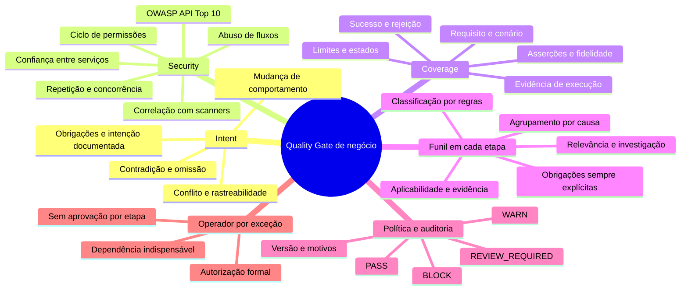

# Quality Gate de negócio — planejamento de evolução

Este repositório reúne o planejamento para aprimorar um Quality Gate já implementado no ambiente corporativo. O objetivo é reduzir achados pouco relevantes, inconsistência de classificação e intervenções do operador, preservando a detecção de violações e a rastreabilidade das decisões.

**Estado deste material:** proposta de arquitetura, algoritmo e exemplos. Não contém uma implementação executável, nem reproduz o código corporativo. Os scripts e schemas descritos abaixo são componentes propostos; nomes, linguagem e critérios devem ser adaptados à implementação real.

## Contexto e mudança desejada

No fluxo atual relatado, cada etapa apresenta seus achados ao operador, aguarda descarte, priorização ou decisão de ação e somente então avança. A proposta elimina essa aprovação por etapa. Cada etapa aplica seu próprio funil e passa resultados estruturados à próxima. Perguntas intermediárias acontecem somente quando falta uma informação indispensável para analisar corretamente a próxima etapa.

Um bloqueio de aprovação não equivale a um bloqueio de execução:

- **Aprovação:** impede liberar a mudança, mas permite continuar o diagnóstico.
- **Execução:** uma dependência ausente impede a análise correta da próxima etapa e não pode ser resolvida com as fontes disponíveis; justifica uma pergunta mínima ao operador.

Ao terminar, o gate pode emitir `REVIEW_REQUIRED` com pendências explícitas, sem iniciar automaticamente outra rodada de perguntas.

## Fronteiras de responsabilidade

Uma única skill/orquestrador executa três etapas sequenciais, com contexto e evidências compartilhados:

1. **Intent Verification:** alinhamento da mudança com BRD, SPEC, TDD e ADRs.
2. **Security Gate:** riscos de segurança ligados aos controles, fluxos e regras do negócio.
3. **Test Coverage Gate:** evidência de testes dos comportamentos e cenários afetados.

A consolidação e a política final pertencem à mesma skill. Não existe uma quarta etapa semântica ou um quarto agente decisor. Checkmarx, SonarQube, mutation testing e checks técnicos externos continuam responsáveis por suas verificações; o gate correlaciona esses resultados com o contexto de negócio.

## Navegação do planejamento

- [Intent: scripts, categorias e algoritmo](#exemplo-detalhado-intent-verification).
- [Security: OWASP API, cobertura externa e triagem](docs/security-planning.md).
- [Coverage: cenários, testes, asserções e execução](docs/coverage-planning.md).

## Fluxo completo em detalhe

O diagrama mostra as três etapas dentro de uma única skill. Cada uma aplica um funil local; candidatos sem sustentação não viram violações confirmadas, mas obrigações e incertezas relevantes permanecem registradas. A evidência compartilhada é referenciada nas passagens entre etapas.

```mermaid
flowchart TD
    INPUT["Diff e referência da mudança<br/>BRD, SPEC, TDD, ADR, contratos e inventário"] --> I1
    EXT["Checkmarx, Sonar, mutation testing e pipeline<br/>Estado, escopo, referência e evidência"] --> S3
    EXT --> T5

    subgraph INTENT["1. Intent Verification"]
        I1["Listar obrigações e comportamentos afetados"] --> I2["Gerar candidatos semânticos<br/>Contradição, omissão, mudança e conflito"]
        I2 --> I3["Validar referências, aplicabilidade e impacto"]
        I3 --> I4["Investigar sustentação<br/>Excluir diferença apenas textual com motivo"]
        I4 --> I5["Agrupar causas e classificar por regras<br/>Preservar obrigações não verificadas"]
        I5 --> IR["Resultado: requisitos, achados,<br/>evidências, pendências e bloqueios"]
    end
    IR --> D1{"Security pode analisar corretamente?"}
    D1 -->|Sim| S1
    D1 -->|Não| R1["Investigar a dependência indispensável<br/>nas fontes disponíveis"]
    R1 --> F1{"Resolvida?"}
    F1 -->|Sim| U1["Atualizar contexto e resultados afetados"]
    F1 -->|Não| Q1["Pergunta mínima ao operador<br/>Sem aprovação dos achados por etapa"]
    Q1 --> U1
    U1 --> D1

    subgraph SECURITY["2. Security Gate"]
        S1["Mapear atores, objetos, tenants,<br/>controles, estados e fronteiras"] --> S2["Selecionar riscos OWASP API aplicáveis<br/>e frentes contextuais"]
        S2 --> S3["Validar cobertura externa<br/>Referenciar ou enriquecer sem duplicar"]
        S3 --> S4["Gerar candidatos contextuais<br/>Validar cenário, controle e consequência"]
        S4 --> S5["Investigar controles compensatórios<br/>Classificar e agrupar por regras"]
        S5 --> SR["Resultado: controles, riscos, cenários,<br/>lacunas externas e pendências"]
    end
    SR --> D2{"Coverage pode analisar corretamente?"}
    D2 -->|Sim| T1
    D2 -->|Não| R2["Investigar a dependência indispensável<br/>nas fontes disponíveis"]
    R2 --> F2{"Resolvida?"}
    F2 -->|Sim| U2["Atualizar contexto e resultados afetados"]
    F2 -->|Não| Q2["Pergunta mínima ao operador"]
    Q2 --> U2
    U2 --> D2

    subgraph COVERAGE["3. Test Coverage Gate"]
        T1["Construir cenários esperados<br/>a partir de Intent e Security"] --> T2["Indexar testes e mapear rastreabilidade"]
        T2 --> T3["Avaliar sucesso, rejeição, limites,<br/>estados e cenários de segurança"]
        T3 --> T4["Verificar asserções, fixtures,<br/>mocks e nível de teste"]
        T4 --> T5["Correlacionar execução por teste e alvo<br/>Distinguir passou, falhou, não rodou e skips"]
        T5 --> T6["Aplicar regras por cenário<br/>Agrupar lacunas sem apagar obrigações"]
        T6 --> TR["Matriz: requisito → cenário → teste → resultado<br/>Adequação e execução separadas"]
    end

    TR --> CONSOLIDATE["Consolidar as três etapas<br/>Correlacionar causas e conservar evidências"]
    CONSOLIDATE --> POLICY["Política determinística versionada<br/>Mesmos resultados estruturados → mesma decisão"]
    POLICY --> B{"Bloqueador ou falha/evidência<br/>mandatória impeditiva?"}
    B -->|Sim| BLOCK["BLOCK"]
    B -->|Não| R{"Revisão formal ou incerteza<br/>crítica pendente?"}
    R -->|Sim| REVIEW["REVIEW_REQUIRED"]
    R -->|Não| W{"Ressalvas permitidas?"}
    W -->|Sim| WARN["WARN"]
    W -->|Não| PASS["PASS: obrigações e evidência mínima satisfeitas"]
    BLOCK --> REPORT["Relatório auditável<br/>Motivos, regras, evidências, ações e pendências"]
    REVIEW --> REPORT
    WARN --> REPORT
    PASS --> REPORT
```



Um P0/P1 ou uma falha mandatória não interrompe, por si só, a passagem entre etapas. Se a resposta indispensável não estiver disponível, a dependência de execução permanece bloqueada; a seta de retorno pressupõe informação efetivamente fornecida e validada. `REVIEW_REQUIRED` no final não inicia automaticamente nova rodada de perguntas.

### Mapa mental das responsabilidades



## Funil dentro de cada etapa

1. **Listar obrigações aplicáveis:** requisitos, controles ou cenários necessários e suas evidências mínimas.
2. **Gerar candidatos semanticamente:** apresentar referências, comportamento afetado e consequência concreta.
3. **Validar referências e estrutura:** conferir IDs, versões, trechos, schemas e origem dos campos.
4. **Verificar sustentação e relevância:** distinguir mudança de comportamento, violação e diferença textual.
5. **Correlacionar e agrupar:** consolidar por causa e correção demonstradas, preservando requisitos e impactos distintos.
6. **Classificar por política:** manter severidade, confiança, verificação e resolução separados.
7. **Investigar incertezas:** aproveitar documentos, código, testes e resultados existentes antes de perguntar.
8. **Emitir resultado estruturado:** achados, exclusões justificadas, obrigações não verificadas e dependências de execução.

As obrigações são avaliadas independentemente dos candidatos. Se o modelo não levantar um achado, isso não comprova que o requisito foi atendido.

## Determinismo: alcance e limites

Para os mesmos resultados estruturados, evidências e versão da política, scripts de triagem devem produzir os mesmos encaminhamentos e motivos. Ordenação e agrupamento também precisam ser estáveis.

A interpretação semântica ainda pode variar. Validar uma referência prova que ela existe, não que sustenta a conclusão. Uma segunda revisão semântica também não constitui prova independente. Execuções reproduzíveis, testes existentes e relações explícitas oferecem sustentação adicional quando disponíveis.

Registrar versões da política, configuração da análise, referências dos documentos e identidade da mudança permite investigar diferenças. Não usar um score agregado ou similaridade semântica como substituto para obrigação, impacto e evidência.

## Exemplo detalhado: Intent Verification

### Componentes propostos

Python é uma opção para os auxiliares, sem definir a linguagem do sistema corporativo.

```text
quality-gate/
├── SKILL.md
├── schemas/
│   ├── requirement.schema.json
│   ├── intent-candidate.schema.json
│   └── stage-result.schema.json
├── policies/
│   └── intent-v1.json
└── scripts/
    ├── collect_change.py
    ├── index_requirements.py
    ├── validate_candidates.py
    ├── triage_intent.py
    └── render_report.py
```

Essa árvore é ilustrativa; os arquivos não estão implementados neste repositório.

| Componente | Método e responsabilidade | Limite |
|---|---|---|
| `collect_change.py` | Ler diff entre referências explícitas; coletar trechos antes/depois; registrar IDs e hashes. | Arquivo alterado não prova mudança de comportamento. |
| `index_requirements.py` | Indexar IDs, versões, trechos e relações explícitas dos documentos. | Não inventar obrigações nem resolver conflitos silenciosamente. |
| Análise semântica na skill | Relacionar obrigação e mudança; gerar candidatos com consequência e evidências. | Não decide livremente a liberação. |
| `validate_candidates.py` | Validar schema, enums, referências e correspondência dos trechos. | Não comprova significado. |
| `triage_intent.py` | Aplicar regras de admissão, classificação, agrupamento e continuidade. | Não interpretar significado por palavras-chave. |
| `render_report.py` | Exibir decisões, motivos, evidências e pendências. | Não recalcular semanticamente a decisão. |

Artefatos de execução devem ficar fora dos arquivos de aplicação. Os auxiliares não precisam modificar código, testes ou documentos de requisitos.

### Representar uma obrigação

```json
{
  "id": "SPEC-AUTH-017",
  "source": {"document": "SPEC", "version": "3", "section": "4.2"},
  "subject": "exportacao_de_relatorio",
  "condition": "usuario_sem_permissao_de_exportacao",
  "expected_behavior": "negar_exportacao",
  "mandatory": true,
  "criticality": "high",
  "control": "authorization",
  "scope": ["reports.export"]
}
```

Campos extraídos de texto livre precisam conservar o trecho original e o estado da interpretação. Uma obrigação inferida ou ambígua não deve parecer uma exigência explícita.

O mapeamento usa, em ordem de sustentação disponível: relações explícitas de IDs e rastreabilidade; relações estruturais de chamadas, rotas e dependências; busca semântica para recuperação; confirmação semântica de aplicabilidade. Similaridade recupera candidatos, mas não prova aplicabilidade. A ausência de uma relação encontrada não prova ausência de impacto.

### Categorias delimitadas

| Categoria | Condição para propor | Evidência insuficiente |
|---|---|---|
| `requirement_contradiction` | Comportamento alterado conflita com obrigação aplicável. | Termos diferentes entre código e documento. |
| `requirement_omission` | Obrigação aplicável deixou de ser atendida no escopo analisado. | Ausência de uma palavra ou função no diff. |
| `behavior_change` | Mudança observável cuja compatibilidade com a intenção precisa ser avaliada. | Refatoração sem efeito demonstrado. |
| `document_conflict` | Fontes aplicáveis prescrevem comportamentos incompatíveis sem precedência resolutiva. | Níveis diferentes de detalhe. |
| `traceability_gap` | Não há ligação verificável entre obrigação aplicável e implementação analisada. | Não prova, por si só, um defeito da aplicação. |

`not_verified`, `inconclusive` e `planned_change` são estados, não categorias de defeito. Mudança de comportamento não é automaticamente violação.

### Candidato ilustrativo

```json
{
  "id": "INTENT-001",
  "category": "requirement_contradiction",
  "requirement_refs": ["SPEC-AUTH-017"],
  "change_refs": ["DIFF-004"],
  "evidence_refs": ["REQ-017-TEXT", "CODE-BEFORE-08", "CODE-AFTER-08"],
  "behavior_before": "exportacao exige permissao",
  "behavior_after": "exportacao exige apenas autenticacao",
  "impact": "usuario autenticado sem permissao pode exportar",
  "confidence": "high",
  "verification_status": "inconclusive",
  "resolution_status": "open",
  "suggested_severity": "P1",
  "root_cause_ref": "CHANGE-AUTH-GUARD-08"
}
```

O candidato começa inconclusivo: a guarda removida pode ser compensada por outra camada. A confiança sugerida pelo modelo não substitui essa investigação.

### Validação e investigação

A validação mecânica confere existência e versão dos requisitos, correspondência de trechos, referências do diff, campos obrigatórios, enums e proveniência. A investigação semântica verifica aplicabilidade, controles equivalentes, alcance da consequência e eventuais ADRs ou alterações planejadas.

Falhas de validação ficam registradas e podem exigir recuperação de evidência. Se impedirem comprovar uma obrigação mandatória, influenciam o estado dessa obrigação; não desaparecem como ruído.

### Regras iniciais de triagem

| Regra | Condição | Resultado |
|---|---|---|
| `I-01` | Referência inválida ou trecho incompatível. | Não confirmar violação; registrar falha e tentar recuperar evidência. |
| `I-02` | Divergência apenas textual, sem consequência demonstrada. | Excluir da fila de decisão com justificativa. |
| `I-03` | Violação sustentada de obrigação explícita e mandatória. | Registrar achado e bloqueio de aprovação conforme política. |
| `I-04` | Consequência potencialmente grave com sustentação insuficiente. | Investigar; persistindo, registrar análise crítica inconclusiva. |
| `I-05` | Conflito documental com precedência conhecida. | Aplicar precedência e registrar fontes. |
| `I-06` | Conflito relevante sem resolução. | Registrar pendência; pausar somente se impedir a próxima análise. |
| `I-07` | Mesma causa e mesma correção demonstradas. | Consolidar sem eliminar requisitos ou impactos distintos. |
| `I-08` | Obrigação mandatória sem evidência mínima. | Registrar `not_verified`; aplicar política, nunca presumir aprovação. |

Categorias de impacto precisam de tabelas corporativas com exemplos positivos e negativos. Uma violação de autorização pode ter gravidades diferentes conforme recurso, alcance e consequência; a categoria não determina automaticamente P0. Baixa confiança não reduz severidade potencial.

### Algoritmo ilustrativo

O pseudocódigo apresenta a ordem das decisões. As funções precisam ser especificadas e validadas na implementação real; este trecho não é executável nem foi testado como aplicação.

```python
def analyze_intent(change, documents, external_results, policy):
    evidence = collect_evidence(change, documents, external_results)
    obligations = identify_applicable_obligations(evidence, policy)
    candidates = semantic_analysis(
        evidence=evidence,
        obligations=obligations,
        categories=policy.allowed_categories,
    )
    findings, exclusions, pending = [], [], []

    for candidate in candidates:
        validation = validate_references_and_schema(candidate, evidence)
        if not validation.valid:
            pending.append(evidence_recovery_request(candidate, validation))
            continue

        assessment = investigate_semantic_support(candidate, evidence)
        if assessment.text_only_difference:
            exclusions.append(exclude(candidate, rule="I-02"))
            continue
        if assessment.potentially_critical and not assessment.sufficient:
            pending.append(critical_uncertainty(candidate, assessment))
            continue
        if not assessment.sufficient:
            pending.append(unverified_candidate(candidate, assessment))
            continue

        findings.append(classify_by_policy(candidate, assessment, policy))

    obligation_status = assess_obligation_evidence(
        obligations, evidence, findings, pending, policy
    )
    groups = consolidate_supported_root_causes(findings, policy)
    execution_blockers = identify_downstream_dependencies(
        obligation_status, pending, next_stage="security"
    )
    return {
        "findings": groups,
        "obligation_status": obligation_status,
        "pending": pending,
        "exclusions": exclusions,
        "approval_blockers": evaluate_approval_blockers(
            groups, obligation_status, policy
        ),
        "execution_blockers": execution_blockers,
        "can_continue": len(execution_blockers) == 0,
        "policy_version": policy.version,
    }
```

### Exemplo completo de encaminhamento

Uma mudança substitui permissão de exportação por autenticação. O mapeamento encontra `SPEC-AUTH-017`; a análise gera contradição; as referências são validadas; a investigação busca autorização equivalente em middleware ou serviço.

- Controle equivalente demonstrado: excluir candidato com justificativa.
- Violação comprovada: registrar achado e bloqueio de aprovação.
- Evidência insuficiente: registrar obrigação não verificada ou análise inconclusiva, conforme os critérios.

Security continua quando dispõe de contexto suficiente, sem exigir classificação humana do candidato.

Saída ilustrativa para uma violação comprovada:

```json
{
  "stage": "intent",
  "policy_version": "intent-v1",
  "findings": [{
    "id": "INTENT-001",
    "category": "requirement_contradiction",
    "severity": "P1",
    "confidence": "high",
    "verification_status": "verified",
    "resolution_status": "open",
    "rule_ids": ["I-03"],
    "operator_action_required": false
  }],
  "approval_blockers": ["INTENT-001"],
  "execution_blockers": [],
  "can_continue": true
}
```

`operator_action_required: false` significa que a análise pode concluir e avançar sem uma decisão humana. Não elimina a necessidade de corrigir a violação. Aceites e exceções, quando permitidos, exigem autorização formal, justificativa e escopo.

## Planejamento detalhado de Security

O [Security Gate de APIs](docs/security-planning.md) detalha o catálogo OWASP API Security Top 10 (edição 2023), quatro frentes contextuais complementares, cobertura externa, scripts propostos, regras de triagem, algoritmo e exemplo de encaminhamento. É documentação de planejamento, sem scripts executáveis ou alegação de cobertura comprovada no pipeline corporativo.

## Planejamento detalhado de Coverage

O [Test Coverage Gate](docs/coverage-planning.md) descreve doze dimensões de avaliação, estados separados de descoberta/adequação/execução, scripts propostos, onze regras, pseudocódigo e exemplo completo. Evidência de teste aprovado não comprova automaticamente o comportamento: a matriz preserva cenário, asserções necessárias e escopo da execução.

## Política final

Precedência proposta: `BLOCK` → `REVIEW_REQUIRED` → `WARN` → `PASS`.

| Saída | Condições principais |
|---|---|
| `BLOCK` | Violação impeditiva não resolvida, falha obrigatória externa ou evidência mandatória ausente quando exigida pela política. |
| `REVIEW_REQUIRED` | Sem bloqueador prevalente, mas com decisão formal pendente, conflito relevante ou análise crítica inconclusiva. |
| `WARN` | Sem bloqueador ou revisão obrigatória; ressalvas ou riscos permitidos pela política. |
| `PASS` | Obrigações satisfatoriamente verificadas, evidências mínimas presentes e ausência de bloqueadores e revisões obrigatórias. |

Mesmo quando `BLOCK` prevalece, o relatório conserva pendências de revisão. Não usar média de severidades. Exceções de P0/P1 não equivalem a descarte informal.

## Interação mínima com o operador

Antes de perguntar, registrar a informação ausente, as tentativas de obtê-la, a etapa afetada e por que respostas diferentes alterariam a execução. Dúvidas que não invalidam a próxima análise permanecem no resultado final.

Se houver várias dependências indispensáveis, agrupar perguntas por resposta ou causa compartilhada. Priorizar o que destrava execução e autorizações obrigatórias. Limites de apresentação não podem ocultar bloqueadores ou pendências críticas.

## Plano de evolução no ambiente corporativo

1. Mapear implementação atual, schemas, prompts, perguntas e integrações sem alterar seu comportamento.
2. Registrar baseline com mudanças representativas e decisões esperadas.
3. Normalizar schema e proveniência de evidências; separar dimensões dos achados.
4. Especificar tabelas de aplicabilidade, impacto, evidência mínima e precedência documental.
5. Introduzir funil de Intent em modo comparativo, sem mudar decisões de produção.
6. Aplicar o mesmo contrato a Security e Coverage, respeitando suas responsabilidades.
7. Substituir aprovação por etapa pelo teste explícito de dependência de execução.
8. Validar política final e adotar gradualmente com comparação auditável.

## Validação proposta

Comparar antes/depois: candidatos e causas distintas, perguntas, tempo de revisão, falsos positivos, violações omitidas, detecção de P0/P1, duplicação com ferramentas externas e variação entre execuções repetidas.

Casos necessários: divergência textual sem impacto; requisito omitido; controle compensatório; conflito documental; obrigação sem evidência; P0/P1 incerto; mesma causa com múltiplos impactos; bloqueio de aprovação que permite continuar; dependência indispensável que exige pausa.

Testes de tabela devem garantir que os mesmos dados e política resultem na mesma triagem; obrigações mandatórias nunca desapareçam; agrupamento preserve informação; baixa confiança não rebaixe impacto; saída final conserve justificativas.

Reduzir perguntas só constitui melhoria se controles obrigatórios e riscos relevantes continuarem cobertos. Nenhum resultado de teste corporativo é alegado neste repositório.

## Referências e próximos detalhamentos

O pacote original fornecido para contexto está preservado em [docs/context](docs/context/README.md). Ele contém um plano anterior de refatoração; este README incorpora a confirmação de que a implementação existe no ambiente corporativo e a preferência por funis locais, com pausas somente por dependências indispensáveis.

Detalhamentos ainda necessários: exemplos sanitizados da implementação atual; tabelas corporativas de impacto; critérios de evidência mínima; regras de precedência documental; contrato de entrada dos checks externos; critérios de agrupamento; catálogo de dependências entre etapas; métricas e limiares de adoção.
